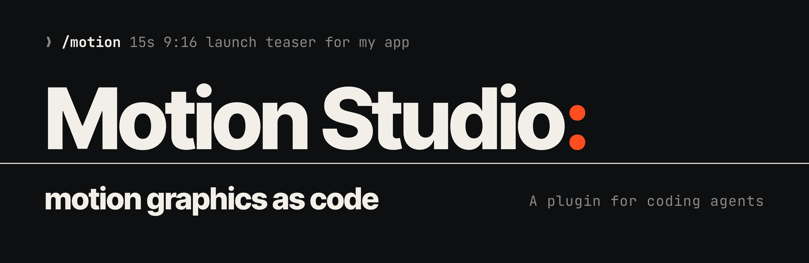
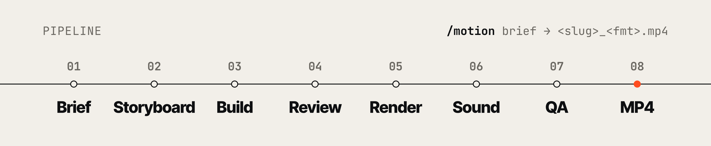
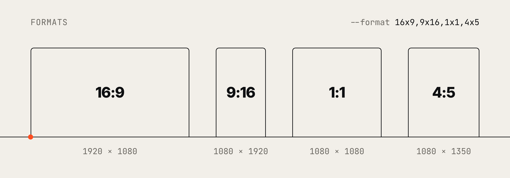
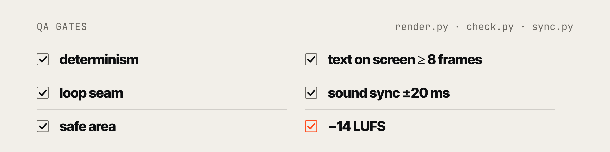

<p align="center">
  
</p>

<p align="center">
  <a href="CHANGELOG.md"></a>
  <a href="LICENSE"></a>
  
  
</p>

<p align="center">
  <a href="#install">Install</a> ·
  <a href="#one-command-idea--mp4">Quick start</a> ·
  <a href="#commands">Commands</a> ·
  <a href="#step-by-step-inspire--brief--build--render">Step by step</a> ·
  <a href="#whats-inside">What's inside</a> ·
  <a href="#licence">Licence</a>
</p>

---

**Motion Studio** is a plugin for coding agents that makes motion graphics as code. Your agent
writes the animation as an HTML/SVG/Canvas/GSAP/Three.js composition, then renders it
frame-exact to MP4 in every format you ask for, with synced sound effects and an automated QA pass.

```
❯ /motion 15s 9:16 launch teaser for my app
```

**Every frame is a function of time.** No clocks, no timers, no unseeded randomness. Same `t`,
same frame. That is what makes renders exact, repeatable and fixable with small edits.

**No generative media models.** Motion Studio never calls an image, video or audio generation
model. The agent writes code (HTML, SVG, Canvas, Three.js), headless Chromium renders that code
frame by frame, ffmpeg encodes it, and sound effects are synthesized from math in `sfx.py`.
Everything runs on your machine. See [What runs on your machine](#what-runs-on-your-machine).

## The film

<!--
  Inline player: the MP4 is uploaded as a GitHub attachment (README web editor, drag and drop),
  so the video file itself is not stored in the repository.
-->

https://github.com/user-attachments/assets/9f9734a2-e2af-497f-a4cc-b6172d769402

<p align="center"><sub>The launch film, made with Motion Studio: 36 s, 16:9, with sound.</sub></p>

## How it works

<picture>
  <source media="(prefers-color-scheme: dark)" srcset="docs/assets/pipeline-dark.png">
  
</picture>

1. **Brief.** A concept, a hex palette, fonts, locked copy, formats, motion rules, a sound plan and a banned list.
2. **Storyboard.** A timed beat table you can approve before anything is built.
3. **Build.** One deterministic HTML composition from a template and the shared motion kit.
4. **Review.** Gates and a contact sheet per format, fixed before the full render.
5. **Render.** Headless Chromium seeks every frame via `window.seek(t)`, with sub-frame motion blur.
6. **Sound.** Synthesized SFX on the visual hits, your track on the beat grid, mixed to −14 LUFS.
7. **QA.** Blank frames, one-frame pops, frozen stretches, loop seam, loudness and sync.
8. **MP4.** One file per format, plus posters, contact sheets, `deliver.json` and the editable HTML.

Scored critic rounds run on request.

<picture>
  <source media="(prefers-color-scheme: dark)" srcset="docs/assets/formats-dark.png">
  
</picture>

One timeline serves every format. Only the layout changes, and 9:16 keeps text clear of the
Reels/TikTok buttons and captions.

## Install

**Requirements**

```bash
pip install playwright numpy pillow
python3 -m playwright install chromium
# ffmpeg on PATH (brew install ffmpeg / apt install ffmpeg / winget install ffmpeg)
# npm, only if you vendor three.js or GSAP
# optional: pip install librosa (beats.py uses it for tempo if present; a numpy fallback is built in)
```

**Claude Code**

```
/plugin marketplace add sarupurisailalith/motion-studio
/plugin install motion-studio@motion-studio
```

For local testing: `git clone https://github.com/sarupurisailalith/motion-studio && claude --plugin-dir ./motion-studio`.

**Claude app (claude.ai / desktop).** Zip the skill folder and upload it under Settings → Capabilities → Skills:

```bash
cd skills && zip -r ../motion-video.zip motion-video
```

The app's sandbox can render short pieces; long or WebGL-heavy renders run better on your own
machine. In app chat only the skill loads (no slash commands, no critic agent), so ask in plain
words. If you ask for a review, the agent runs the critic rounds itself as an explicitly fresh
pass, using the rubric in the skill.

## Commands

There are two ways to work: give everything to one command and get an MP4 back, or go step by
step with the smaller commands when you want to shape the idea first.

| Command | Input | Output |
|---|---|---|
| `/motion` | What the video is about (or a `brief.md`), plus any of: duration, formats, style, asset files, a music track | The finished MP4 per format with sound, posters, contact sheets, `deliver.json`, the critic's scores and the HTML source |
| `/motion-inspire` | A subject or style | Three original concepts and a recommended pick |
| `/motion-brief` | A rough idea, plus any asset files | `motion/<slug>/brief.md`, a production brief with a storyboard |
| `/motion-assets` | Files, folders or chat attachments (logo, screenshots, fonts, clips, audio, brand guide) | `motion/<slug>/assets/` with `assets.json`, ready to use by id |
| `/motion-audio` | A composition, plus an optional `--track` and `--vo` | SFX on the composition's hits, a −14 LUFS mix muxed into every rendered format, a sync report |
| `/motion-render` | An existing HTML animation, plus formats and flags | QA-checked MP4s (one per format), optionally the deliver bundle |

Commands are namespaced by the plugin, so `/motion-studio:motion` also works if another plugin
has a `/motion`. You can also skip commands and ask in plain words, e.g. "make a 30-second recipe
explainer video for filter coffee". The skill triggers by itself.

### One command: idea → MP4

Put everything you know in one line. Whatever you leave out gets a sensible default, and the
agent tells you what it chose.

```
/motion 15s launch teaser for Tally, a habit-tracking app, for Reels and the feed (9:16 + 1:1).
Warm off-white background, one orange accent (#FF6A1A), tagline "Small days add up".
Logo: ~/Desktop/tally/logo.svg. Music: ~/Music/tally-theme.mp3
```

What happens:

1. **Questions, only if needed.** If something only you can provide is missing (your logo,
   exact copy or numbers, a music track), the agent asks for it in one batch. Otherwise it
   carries on. Files you name or attach are copied into the project's `assets/` and used
   as-is, never redrawn.
2. **Brief.** The agent picks the closest genre playbook (here a launch teaser) and writes a
   brief: a one-line concept, a hex palette, fonts, locked copy, formats, motion rules, the
   sound plan (music + which visual hits get a sound effect) and a banned list.
3. **Storyboard.** A timed beat table, for example:

   | time | on screen |
   |---|---|
   | 0.0–1.5 s | A single orange dot lands on an empty calendar grid |
   | 1.5–6.0 s | The days fill one by one, accelerating into a streak |
   | 6.0–11.0 s | The streak bends into the Tally app UI |
   | 11.0–15.0 s | "Small days add up", then the logo lockup and a held end frame |

   If you're watching, the agent shows you this and the format list, and waits for your OK.
4. **Build.** One HTML composition in `motion/tally-teaser/`, built from a template so that
   every frame is a pure function of time. Scenes are cut to your track's beats.
5. **Review.** Gates first, then one contact sheet per format. The agent looks at it and fixes
   problems before spending time on the full render.
6. **Render + sound + QA.** A frame-by-frame render with motion blur in each format, sound
   effects synthesized on the visual hits, a mix with your track mastered to −14 LUFS and
   muxed into every file, then `check.py`.
7. **Deliver.** The agent shows you the videos. You get:
   ```
   motion/tally-teaser/
   ├── brief.md
   ├── critique.md                     ← critic rounds, if you asked for them
   ├── tally-teaser.html               ← editable master: change copy/colours, re-render
   ├── kit.js  beats.js  music.wav
   ├── assets/                         ← your logo, as supplied
   ├── audio/  sfx.wav  mix.wav
   └── renders/
       ├── deliver.json                ← what's in the bundle (size, fps, audio …)
       ├── tally-teaser_9x16.mp4   tally-teaser_9x16_poster.png   tally-teaser_9x16_sheet.png
       └── tally-teaser_1x1.mp4    tally-teaser_1x1_poster.png    tally-teaser_1x1_sheet.png
   ```

To change something afterwards, just ask ("make the streak faster", "swap the accent to teal").
The agent edits the HTML and re-renders. Nothing is rebuilt from scratch.

**Want a second opinion?** Say "review it" (or add `--review` to `/motion`, or `--review 3` for
three rounds). The `motion-critic` agent reviews the renders with fresh eyes and scores hook,
readability, motion, variety, brand, sync and concept (1–10), with the top 3 timestamped fixes
and a *ship / one more pass* verdict. The builder fixes, re-renders and repeats (2 rounds for a
social clip, 3 for a hero piece by default, at most 4). Every round goes into `critique.md`.
Critic rounds are off by default because each one costs several image reads and a re-render.

### Step by step: inspire → brief → build → render

Use this when you don't have a concept yet, or you want to approve the plan before anything
gets built.

<details>
<summary><b>1. Explore concepts</b> (optional)</summary>

```
/motion-inspire 20-second explainer on how a pour-over coffee extracts
```

You get three different concepts. Each has a one-line visual rule, duration and aspect,
3–5 timed beats, a transition approach and a build technique. One is recommended.
</details>

<details>
<summary><b>2. Lock the brief</b></summary>

```
/motion-brief concept 2: water as a single amber line that stays continuous through every scene; 20s, 1:1
```

This writes `motion/pour-over-explainer/brief.md`. Anything only you can supply is marked
`[[TODO: …]]`, and the brief ends with a list of what's still needed. Edit the file directly if
you want to change the copy, palette, formats, sound plan or timing.
</details>

<details>
<summary><b>3. Bring your assets</b> (optional)</summary>

```
/motion-assets ~/Desktop/brand/logo.svg ~/Desktop/brand/fonts/ ~/Desktop/pour.mov
```

Everything is copied into `motion/pour-over-explainer/assets/` and listed in `assets.json`:
images resized, SVGs sanitised, fonts checked, clips turned into frame sequences (so every frame
renders exactly). Missing or unreadable files are named. Files attached in app chat work the
same way.
</details>

<details>
<summary><b>4. Build from the brief</b></summary>

```
/motion build motion/pour-over-explainer/brief.md
```

`/motion` uses the existing brief instead of writing a new one, asks only about its remaining
`[[TODO: …]]` items, then runs the same build → review → render → sound → QA steps.
</details>

<details>
<summary><b>5. Sound</b> (on its own, e.g. after changing the timing or swapping the track)</summary>

```
/motion-audio motion/pour-over-explainer/pour-over-explainer.html --track ~/Music/calm.mp3
```

Beat grid from your track, SFX on the composition's `MOTION.hits`, a −14 LUFS mix muxed into
every rendered format, and a sync report (worst offset in ms). Music must be yours to use; the
plugin never downloads songs.
</details>

<details>
<summary><b>6. Re-render, or render your own animation</b></summary>

```
/motion-render motion/pour-over-explainer/pour-over-explainer.html --format 1x1,9x16 --deliver
/motion-render ./my-existing-animation.html --gl --subframes 6 --audio track.wav
```

This works with any HTML animation. If the file runs on its own clock (rAF loop, CSS animations,
a playing GSAP timeline), the agent first changes it so every frame is computed from `t`,
keeping the look identical.

| Flag | What it does |
|---|---|
| `--format 16x9,9x16,1x1,4x5` | One file per format |
| `--deliver` | Adds a poster and contact sheet per format and `renders/deliver.json` |
| `--subframes N` | Motion blur |
| `--audio file` | Muxed and normalised to −14 LUFS |
| `--gl` | WebGL / Three.js |
| `--scale 2` | Supersampled, crisper type |
</details>

## QA gates

<picture>
  <source media="(prefers-color-scheme: dark)" srcset="docs/assets/gates-dark.png">
  
</picture>

`render.py` checks determinism, the loop seam, safe areas and text duration before the full
render. `check.py` checks the MP4 for blank frames, single-frame pops, frozen stretches, the loop
seam and loudness. `sync.py` measures where each SFX lands against its hit. Any FAIL blocks delivery.

## Previewing a composition

Open the 2D composition HTML in a browser: it plays, <kbd>Space</kbd> pauses, <kbd>←</kbd>/<kbd>→</kbd>
step frames, <kbd>F</kbd> cycles formats and <kbd>G</kbd> shows the safe areas. The Three.js
template uses ES modules, which browsers block from `file://`, so serve its folder first:

```bash
cd motion/<slug> && python3 -m http.server 8000   # then open http://localhost:8000/<slug>.html
```

## What runs on your machine

Motion Studio has no server, no account and no telemetry. The plugin has no hooks and no MCP
servers; it only runs the scripts below, when the agent or you invoke them.

| What runs | What it does | Network |
|---|---|---|
| `render.py` | Serves the composition folder on `127.0.0.1` (random port, local only), drives headless Chromium through Playwright, pipes frames to ffmpeg | None needed. Compositions the plugin builds load libraries from a local `vendor/` folder; your own HTML that links to remote URLs is fetched like in any browser |
| `check.py`, `sync.py`, `beats.py`, `sfx.py`, `mix.py` | Analyse and mix audio and video with ffmpeg/ffprobe and numpy | None |
| `ingest.py` | Copies your asset files into `motion/<slug>/assets/`, sanitising SVGs and converting clips with ffmpeg | None |
| `brand.py` | Reads the ingested logo, screenshots, fonts and brand guide; writes `brand.json` and a swatch image | None |
| `scaffold.py`, `doctor.py` | Create a project folder from a template; check dependencies and print install commands (installs nothing) | None |
| `vendor.py` | Copies three.js, GSAP or lottie into `vendor/` so renders stay offline | Downloads exact pinned versions (`three@0.186.1`, `gsap@3.15.0`, `lottie-web@5.13.0`) from the npm registry |
| Setup (you run it once) | `pip install …` and `python3 -m playwright install chromium` | PyPI and Playwright's Chromium download host |

Files are read only when you name or attach them, and everything the plugin writes goes under
`motion/<slug>/` in your project. It never reads Claude's memory or chat history. Details:
[PRIVACY.md](PRIVACY.md).

## Troubleshooting

| Symptom | Fix |
|---|---|
| `playwright missing` or `numpy missing` | `pip install playwright numpy pillow`, then `python3 -m playwright install chromium` |
| `ffmpeg` / `ffprobe` not found | Install ffmpeg and make sure it's on `PATH` (`ffmpeg -version`) |
| Three.js piece renders black or fails to load modules | Run `vendor.py <project> three`, render with `--gl`, and preview over `http.server`, not `file://` |
| `vendor.py` fails | Needs `npm` and network access to the npm registry; retry or copy the files into `vendor/` by hand |
| A QA gate FAILs (determinism, blank frame, pop, loop seam) | The report names the frame and time; fix that beat and re-render. [`gotchas.md`](skills/motion-video/references/gotchas.md) lists the usual causes |
| SFX land off the hit | Run `sync.py` and adjust `MOTION.hits`; the gate is ±20 ms |
| `/motion` not found | Use the namespaced `/motion-studio:motion`, or check `claude plugin list` shows the plugin enabled |

Still stuck? [Open an issue](https://github.com/sarupurisailalith/motion-studio/issues).

## Privacy and security

Motion Studio collects no data. See [PRIVACY.md](PRIVACY.md). To report a vulnerability, follow
[SECURITY.md](SECURITY.md); please don't open a public issue for it.

## What's inside

<details>
<summary>Repository map</summary>

| Path | What it does |
|---|---|
| `skills/motion-video/` | The workflow skill: brief template, genre playbooks, craft numbers, production notes, engine gotchas, formats, audio and assets references, two starter templates, and the scripts below. |
| `skills/motion-video/templates/` | `composition.html` (2D), `three-composition.html` (Three.js), `gsap-composition.html` (GSAP paused timeline) and `glsl-composition.html` (fragment shader), all built on `kit.js`: the shared motion kit (springs and presets, keyframes, seeded noise, formats and safe areas, beat timing, hits, video clips, image cover/crop and device frames, typography). `examples/` shows the type kit and device frames. Copy the template **and** `kit.js` (or run `scaffold.py`). |
| `skills/motion-video/scripts/render.py` | Headless-Chromium renderer: seeks every frame via `window.seek(t)`, sub-frame motion blur, parallel workers, `--format`, `--deliver` bundle, review renders (`--sheet --phone --strip --poster --contact beats`), `--hits`, and the gates: determinism, loop seam, safe area, text duration. |
| `skills/motion-video/scripts/check.py` | QA on the MP4: blank frames, single-frame pops, frozen stretches, loop seam, loudness, `--sync`, contact sheet. |
| `skills/motion-video/scripts/beats.py` | Beat grid from your track (BPM, downbeats, sections; cuts the best window) or a fixed `--grid`. Writes `beats.js` for the kit. |
| `skills/motion-video/scripts/sfx.py` | Synthesized SFX palette (whoosh, tick, thud, riser, impact …) placed sample-accurately on `MOTION.hits`. |
| `skills/motion-video/scripts/mix.py` | Mixes music, SFX and voice-over, ducks music under VO, masters to −14 LUFS / −1 dBTP, muxes into every format. |
| `skills/motion-video/scripts/sync.py` | Measures where each SFX lands vs. its hit (±20 ms gate) and plots it. |
| `skills/motion-video/scripts/ingest.py` | Copies and normalises your logo, screenshots, fonts, clips (→ frame sequences), audio and docs into `assets/` with an inventory. |
| `skills/motion-video/scripts/vendor.py` | Copies three.js / GSAP / lottie locally so renders never hit the network. |
| `skills/motion-video/scripts/brand.py` | `brand.json` from your local brand files: ranked palette, display/UI fonts, wordmark, guide colours and copy, plus a swatch for the brand confirmation step. |
| `skills/motion-video/scripts/scaffold.py` | New project folder from a template (`2d`, `three`, `gsap`, `glsl`) with `kit.js` and a brief skeleton. |
| `skills/motion-video/scripts/doctor.py` | Checks Python packages, Chromium, ffmpeg and optional extras; prints the exact install commands. |
| `commands/` | `/motion`, `/motion-inspire`, `/motion-brief`, `/motion-assets`, `/motion-audio`, `/motion-render`. |
| `agents/motion-critic.md` | Fresh-eyes reviewer: scores 7 dimensions with evidence, top 3 timestamped fixes, a critique ledger, and a ship / one-more-pass verdict. |
| `docs/` | Performance notes and the README images in `docs/assets/`. |
| `PRIVACY.md`, `SECURITY.md` | Privacy policy and how to report a vulnerability. |

</details>

## Licence

[Apache License 2.0](LICENSE). Free to use, modify and sell. If you redistribute Motion Studio or
something built on it, keep the [`NOTICE`](NOTICE) file and credit the project where your work
shows its third-party notices. To cite it, use GitHub's "Cite this repository" button
([`CITATION.cff`](CITATION.cff)). Videos you make with it are yours, and no credit is required,
though "Made with Motion Studio" is appreciated.

See the [changelog](CHANGELOG.md) for what changed in each release.

---

<p align="center">
  <sub><b>Motion Studio:</b> motion graphics as code · a plugin for coding agents</sub>
</p>
